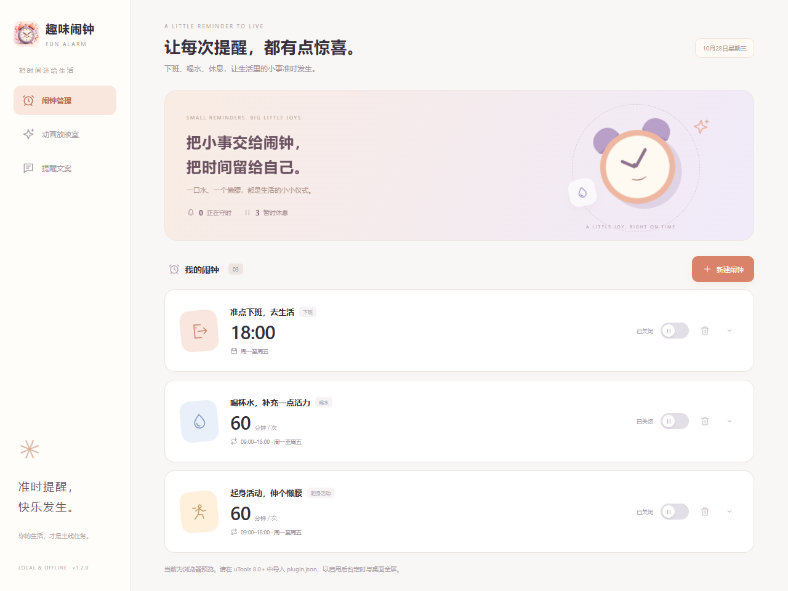
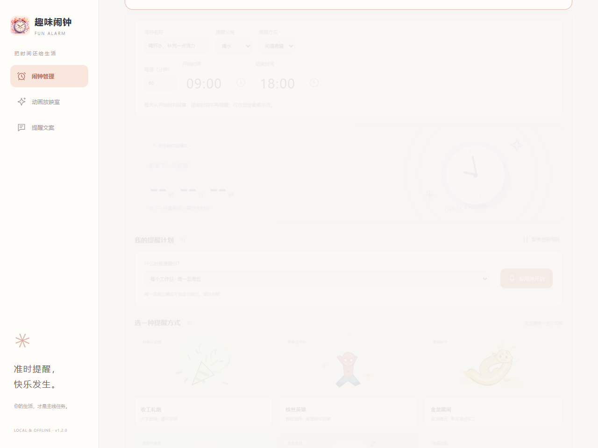
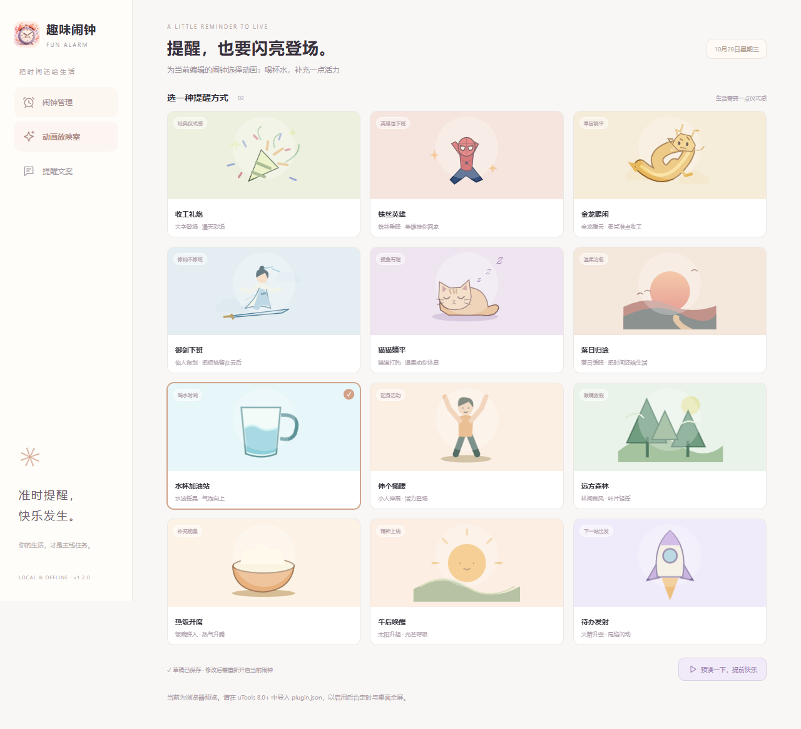
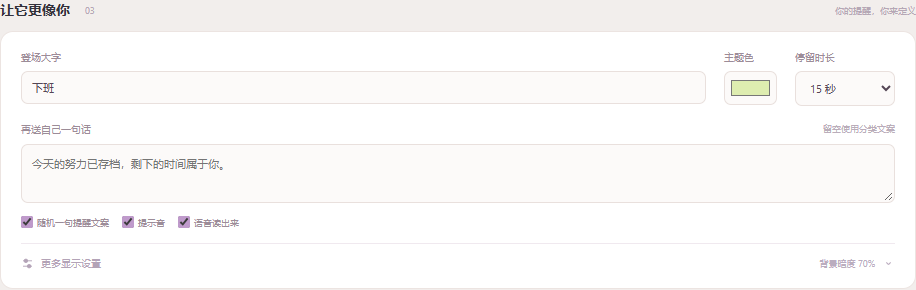
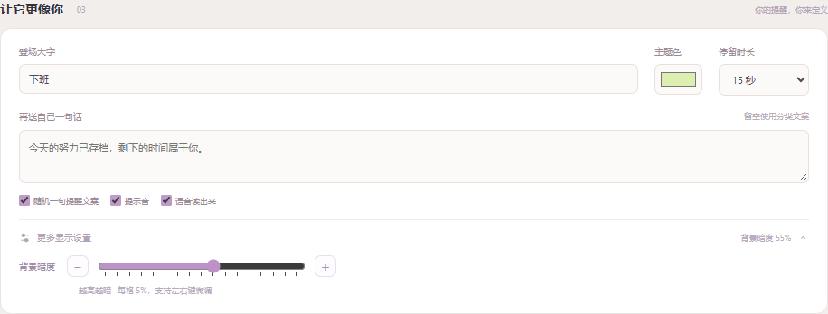
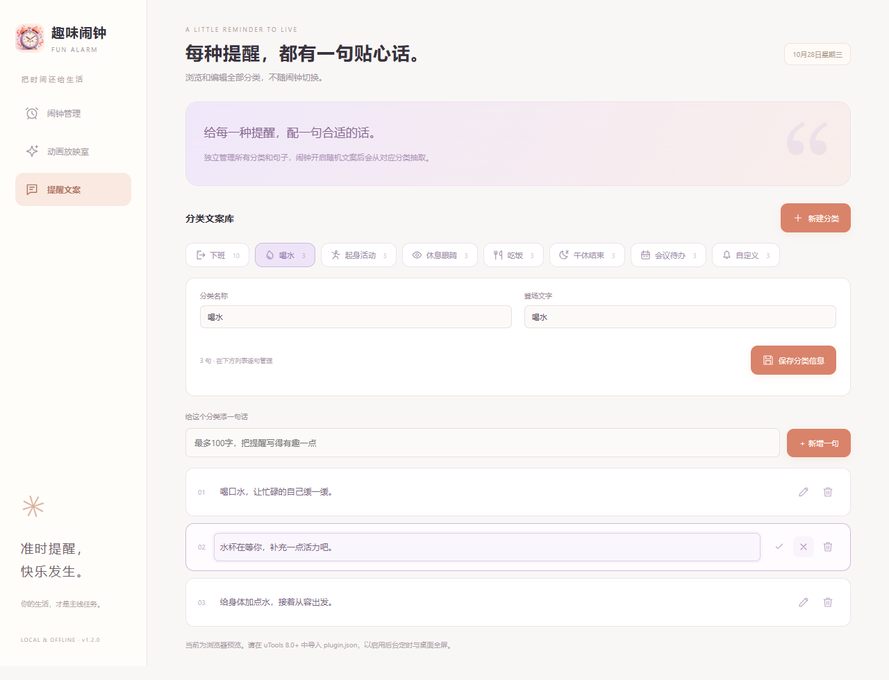
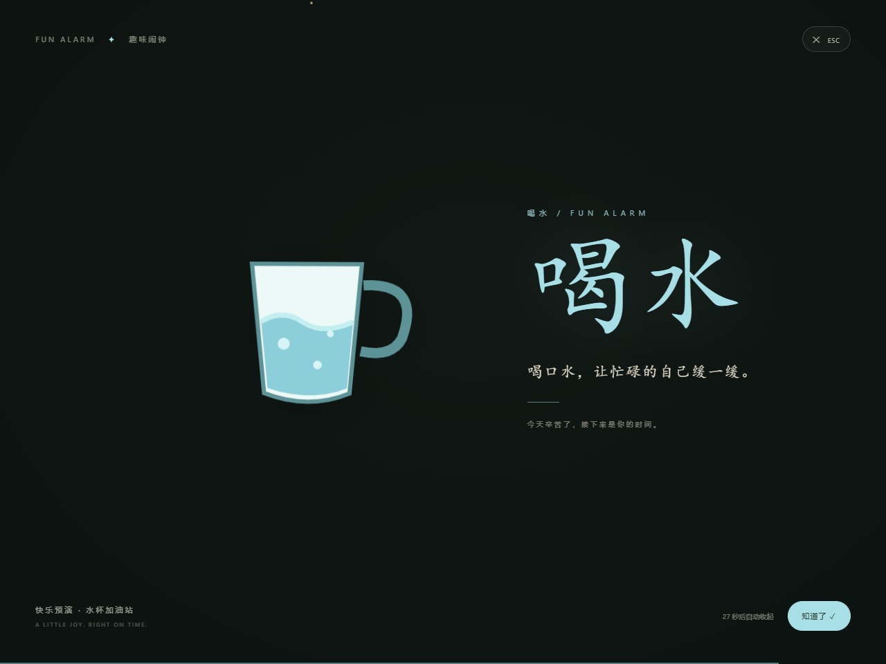
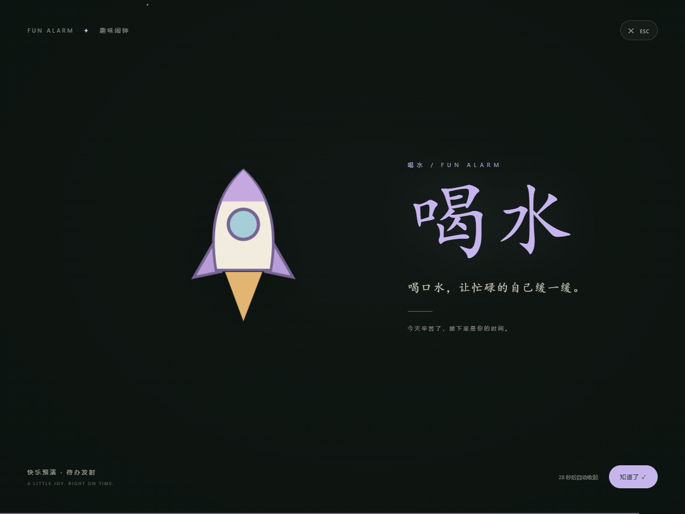

# 趣味闹钟 · FUN ALARM

一个运行在 **uTools 8.0+** 中的全屏动画定时提醒工具。下班、喝水、起身活动、午休结束，都可以用一场趣味动画提醒自己。

当前版本：**1.2.0**。此前未发布的多闹钟、文案库和界面改动已合并到这一版本。

## 界面预览

以下均为 1.2.0 新界面，使用独立的浏览器演示数据，不包含个人闹钟；实际后台定时需在 uTools 中授权。PNG 原图位于 [docs/screenshots](docs/screenshots/)，可用于 README 或市场展示。

### 闹钟管理



### 闹钟详情



### 动画放映室



### 背景暗度调节



数值越高，桌面越暗。滑块每格 5%，可连续拖动，或用减／加按钮、左右键微调；松手后自动保存草稿，重新开启当前闹钟后生效。

低频调整收在默认折叠的「更多显示设置」中，展开后使用紧凑滑块：



### 独立分类文案库



### 趣味提醒





设置提醒时间和重复日期，将「登场大字」改成「喝水」「休息」等文字，再填写对应的提醒文案即可。支持多个独立闹钟；每个闹钟有自己的时间规则、动画和分类文案。在闹钟管理中点击新建，填写名称、分类和规则，分别开启并授权。旧版下班闹钟会自动迁移。

## 直接导入

1. 打开 uTools，在插件应用市场安装并打开官方「uTools 开发者工具」。
2. 创建本地插件应用，选择本目录的 `plugin.json`，按开发者工具提示进入运行/调试。
3. 在 uTools 搜索「趣味闹钟」或「下班闹钟」。
4. 设置下班时间和重复日期，点击「开启提醒」，在 **uTools 弹出的定时任务授权界面确认创建**。
5. 点击「预演一下，提前快乐」测试动画；也可以在 uTools 搜索「我要下班」直接播放当前效果。

如果使用 `release/趣味闹钟-1.2.0.zip`，先完整解压，再选择里面的 `plugin.json`。这是插件源码包；正式离线安装包通过 uTools 开发者工具生成。

## 已实现

- 暖白、珊瑚与雾紫界面，提醒卡片展示时间、分类图标和动画开关；开关状态以实际授权结果为准，支持键盘操作。系统开启减少动态效果后，页面动效会停用。

- 闹钟管理默认只展示列表，点击卡片后在下方动画展开详情，再次点击可收起。
- 「提醒文案」是独立文案库，可查看全部分类，新增分类，逐句新增、编辑或删除文案；保存后可被闹钟随机抽取。内置分类可编辑，正在被闹钟使用的分类不可删除。
- 动画新增水杯气泡、伸展小人、远方森林、热饭蒸汽、午后太阳和待办火箭，共十二种。

- 多闹钟管理：新建、编辑、单独开启、暂停和删除。固定时间支持每天、工作日、自定义星期、仅下一次。间隔提醒支持 5–240 分钟和同日生效时段。
- 原生定时任务托管：主面板不必常驻，到点由 uTools 唤起插件。
- 实际任务倒计时；修改时间/日期后点击「开启提醒」才会替换旧任务。
- 创建新任务后核实是否获授权，取消时保留旧任务；「暂停提醒」只暂停当前闹钟及其稍后提醒，其他闹钟继续运行。
- 十二种离线矢量动画：
  - **收工礼炮**：参考截图的大字登场、暗色透明遮罩、漫天彩纸。
  - **蛛丝英雄**：红蓝蛛丝小英雄从屏幕上方垂降、轻轻摇晃。
  - **金龙赐闲**：卡通金龙腾云飞来，奉旨准点收工。
  - **御剑下班**：仙人踩剑飞入，衣袂、云朵轻轻浮动。
  - **猫猫躺平**：打盹小猫、呼吸起伏和梦境微光。
  - **落日归途**：夕阳、山丘和慢慢飘落的光点。
  - **水杯加油站**：水波摇晃、气泡向上。
  - **伸个懒腰**：伸展小人提醒你起身活动。
  - **远方森林**：林间微风、树叶轻摇。
  - **热饭开席**：饭碗弹入、热气升腾。
  - **午后唤醒**：太阳升起、光芒呼吸。
  - **待办发射**：火箭升空、尾焰闪动。
- 自定义登场大字（最多 6 字）、文案（最多 100 字）、主题颜色、停留时长和遮罩深浅。
- 八种分类文案，按当前闹钟的分类随机抽取；也可自定义。
- 随机文案、和弦提示音、系统中文语音朗读默认开启，遮罩默认 70%。已有保存设置保留原值。
- 多显示器分别覆盖；各屏显示同一句文案，提示音与语音只播放一次。任意屏幕退出或稍后提醒都会同步收起全部屏幕。
- Esc、关闭按钮、「知道了」随时退出，5–60 秒自动关闭。
- 正式提醒中可以选择「再过 10 分钟」，再次经过 uTools 授权创建一次性提醒。
- 设置保存在本机，不请求网络、不收集数据。

## 本地浏览器体验

无需安装依赖，Node.js 14+ 即可：

```sh
npm start
```

打开 `http://127.0.0.1:4173`。可体验设置页、所有主题、文案和自动收起。浏览器里的预演是页面内覆盖，桌面透明置顶与后台定时只在 uTools 中启用。

```sh
npm test
```

25 项测试覆盖日期计算、Cron 规则、默认配置、授权取消保留旧任务、替换及暂停、后台触发、多屏覆盖和关闭、无加载回调时窗口显示、单路音频、稍后提醒去重及入口文件完整性。宿主能力由官方 API 形状模拟，不等同 uTools 真机测试。

## 使用边界

- 间隔提醒每日从开始时刻起算，结束时刻不再提醒，不支持跨午夜；例如 09:10 起每 45 分钟，将在 09:10、09:55、10:40 等时刻提醒。
- 间隔任务由 uTools 每分钟唤起检查一次，只有匹配时段与间隔才播放；休眠期间不会补放错过的提醒。
- 点击列表的闹钟名称切换编辑对象。开启和暂停只影响当前闹钟；删除会移除该闹钟及关联的稍后任务。至少保留一个闹钟。

- 需要保持 **uTools 正在运行**。关机、系统睡眠或退出 uTools 时不能显示动画，错过后的补发行为由宿主决定。
- 工作日为周一至周五，不查询法定节假日或调休。
- 全屏指覆盖当前全部显示器，包括其任务栏区域；按每块显示器的 DIP 边界单独创建窗口，支持负坐标和不同缩放。使用真实透明窗口，让原桌面透出来，不截取桌面图片。
- 屏幕锁定、系统安全桌面等状态可能阻止普通置顶窗口显示。
- 每个闹钟的修改自动保存为草稿，重新点击「开启提醒」并授权后生效。未授权时旧任务和旧配置保持有效。
- 提示音、语音依赖宿主的音频策略和本机语音引擎；浏览器可能要求先交互才能发声。无中文语音时仍保留文字动画。
- 角色是项目内绘制的简洁卡通 SVG，不是影视截图、3D 模型或精细逐帧动画。没有引用外部角色素材或字体。

## uTools 真机验收建议

1. 先预演十二个主题，检查透明背景、Esc、自动退出及按钮。
2. 设置 1–2 分钟后的「仅下一次」任务并授权，退出主面板，等待自动唤起。
3. 保持 uTools 运行，让插件进程自动退出后，再检查定时任务仍能唤起。
4. 修改任务时取消授权，确认原任务仍在；暂停后检查 uTools 任务列表已清空。
5. 触发后选择十分钟后提醒，确认授权弹窗、任务列表和再次唤起。
6. 有多个显示器时检查各屏边界、不同缩放和任务栏覆盖；在任意一屏按 Esc，确认全部窗口退出，声音只播放一次。

## 发布与版本管理

GitHub 用于源码管理，不是插件市场上架的前置条件。市场介绍、隐私说明与发布步骤见 [发布说明](PUBLISH.md)。

## 目录

```text
plugin.json          uTools 入口与指令
preload.js           原生定时任务、存储、全屏窗口
overlay-preload.js   全屏窗口的稍后提醒桥接
index.html/app.js     设置界面
styles.css           设置页样式
core.js              配置、文案、定时规则
alarms.js            多闹钟存储、迁移、授权与独立任务管理
scenes.js            六种本地矢量角色
overlay.html/js/css  动画舞台、粒子、声音与退出
scripts/serve.js     本地预览服务
tests/run.js         核心逻辑与宿主模拟测试
```

## 后续可以增加的有趣方向

以下是创意备选，尚未实现：

- **判官下班令**：「今日功德已结算，禁止继续消耗阳寿。」盖章后放行。
- **熊猫保安清场**：拿小喇叭巡逻，「本工位即将打烊，请带走你的快乐」。
- **宇航员返航**：工位变成太空舱，「地球上的晚饭在等你」。
- **打工电量耗尽**：电量条变成 1%，猫猫举牌「请接入沙发充电器」。
- **周五限定烟花**：每到周五切换周末主题，「本周副本通关」。
- **情绪选台词**：按「疲惫 / 烦躁 / 开心」选择治愈、吐槽或庆祝文案。
- **自定义角色素材**：导入自己的透明 WebP/GIF，搭配已有舞台与文案。

## 官方文档依据

- [开发概览](https://www.u-tools.cn/docs/getting-started/overview.html)
- [plugin.json 配置](https://www.u-tools.cn/docs/development/plugin-json.html)
- [preload 桥接](https://www.u-tools.cn/docs/development/preload.html)
- [原生定时任务与授权](https://www.u-tools.cn/docs/api-reference/schedule.html)
- [透明置顶自定义窗口](https://www.u-tools.cn/docs/development/custom-window.html)
- [定时任务唤起事件](https://www.u-tools.cn/docs/api-reference/events.html)
